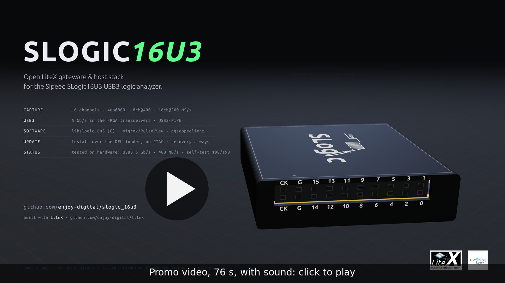
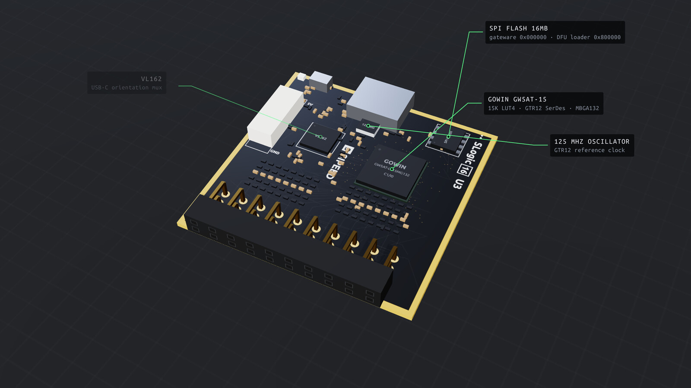
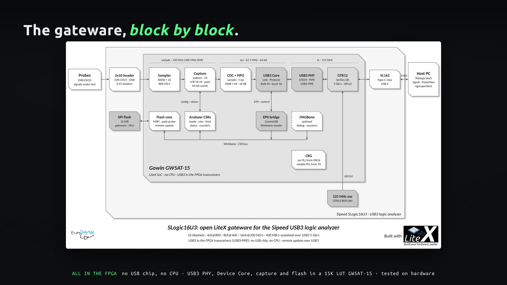
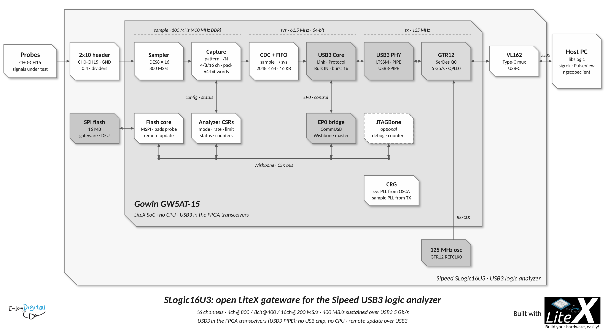
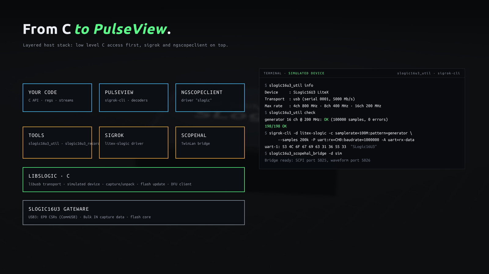
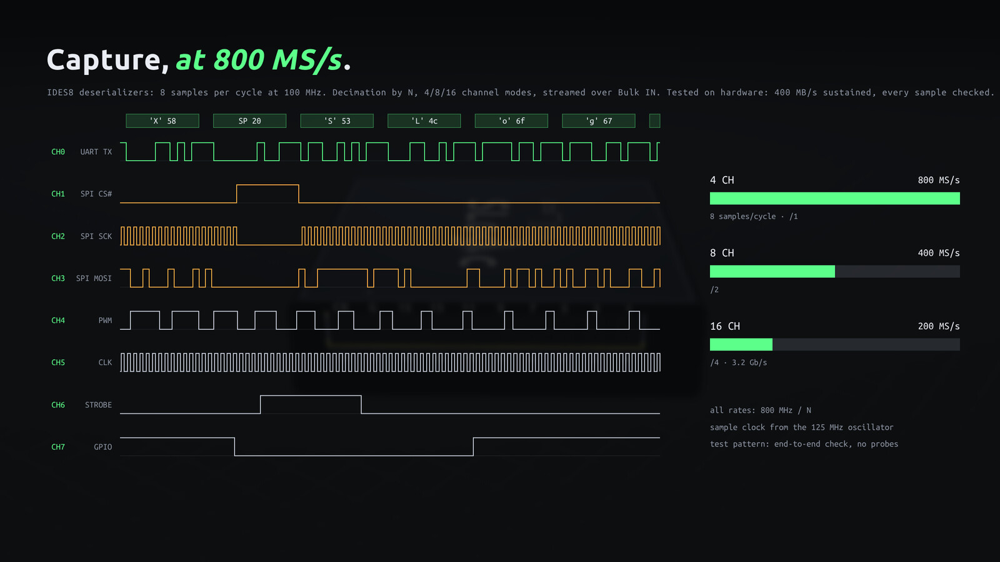
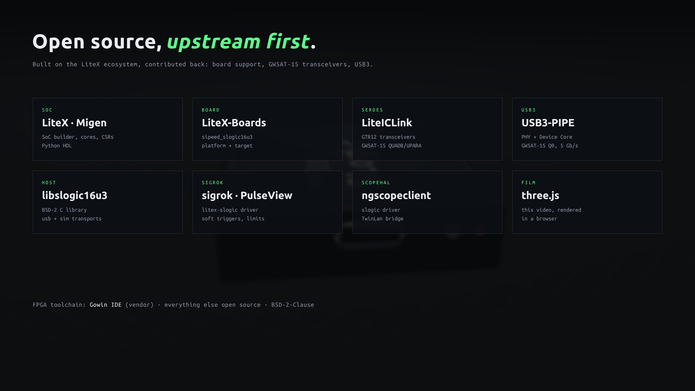

# SLogic16U3

[](doc/images/slogic_16u3.mp4)

<sub>▶ Promo video (76 s, with sound: rendered with three.js and a synthesized soundtrack from
[`doc/illustration`](doc/illustration)). Click the image to play it, also as [mp4](doc/images/slogic_16u3.mp4)
and [still](doc/images/slogic_16u3-hires.jpg).</sub>

**SLogic16U3**: open gateware and host stack for the **Sipeed SLogic16U3** USB3 logic analyzer, an alternative
bitstream built with [LiteX](https://github.com/enjoy-digital/litex) where everything is open from the USB3 PHY
to PulseView:

- **USB3 in the FPGA**: no USB chip on this analyzer, the Gowin GW5AT-15 transceiver is the USB3 PHY.
  [USB3-PIPE](https://github.com/enjoy-digital/usb3_pipe) implements the PIPE, LTSSM, Link/Protocol layers and
  endpoints in the fabric (5Gbps).
- **Simple gateware around the USB3 core**: IDES8 deserializers (800MS/s base), capture core (decimation, 4/8/16
  channel modes, sample-exact limits, overflow detection, test pattern), raw Bulk IN streaming, CSRs over EP0.
- **Low level C access**: `libslogic16u3` (USB3 transport + a simulated device), `slogic16u3_util`/`slogic16u3_record` tools.
- **sigrok/PulseView**: native libsigrok driver (`litex-slogic`), **ngscopeclient**: TwinLan bridge + scopehal
  driver.
- **Remote update, never bricked**: Flash update from the gateware (pads probed at runtime) or through the Sipeed
  DFU loader, which is never written: the MODE button always gets back to it.
- **Tested before the hardware**: Migen unit tests, USB3 host model ↔ Device Core ↔ SoC system simulation, C unit
  tests and sigrok/ngscopeclient end-to-end tests on the simulated device.

> **Status: hardware bring-up in progress.** USB3 enumerates at 5Gbps on the SLogic16U3, the self-test captures
> pass on hardware at the full 400MB/s (all channel modes, sustained), the pattern generator checks the full chain
> without probes, install over the Sipeed DFU loader works (no JTAG, [doc/INSTALL.md](doc/INSTALL.md)); inputs and
> remote updates are next: see [doc/PLAN.md](doc/PLAN.md). The stock firmware can always be restored from the DFU
> loader.

| | |
|:---:|:---:|
| [](doc/images/slogic_16u3-inside.jpg) | [](doc/images/slogic_16u3-architecture.jpg) |
| Gowin GW5AT-15 (USB3 in the GTR12 transceiver), 16 inputs, 16MB SPI Flash, 125MHz oscillator. | CH0-CH15 → IDES8 → Capture → FIFO → USB3 Device Core → GTR12 → USB-C. |

## Architecture

[](doc/images/slogic_16u3-diagram.svg)

| Channels | Max samplerate | Bandwidth | | Samplerates |
|---|---|---|---|---|
| 4  | 800MS/s | 3.2Gb/s | | 800MHz/N: 800, 400, 266, 200, 160, 100 ... MHz |
| 8  | 400MS/s | 3.2Gb/s | | down to the kHz range |
| 16 | 200MS/s | 3.2Gb/s | | |

Details: [doc/GATEWARE.md](doc/GATEWARE.md) (clocks, cores, registers, resources), [doc/HARDWARE.md](doc/HARDWARE.md)
(pinout, flash layout, DFU loader, stock protocol).

## Software

| | |
|:---:|:---:|
| [](doc/images/slogic_16u3-software.jpg) | [](doc/images/slogic_16u3-capture.jpg) |
| libslogic16u3 (C) → tools, sigrok/PulseView, ngscopeclient. | Raw samples streamed over USB3. |

```sh
make -C software/user && make -C software/user check     # libslogic16u3, tools, unit tests.
software/user/build/slogic16u3_util info
software/user/build/slogic16u3_util check                    # Self-test (counter + pattern generator, all modes/rates).
software/user/build/slogic16u3_record -r 100M -c 16 -n 1M -o capture.vcd

software/sigrok/build.sh --pulseview                     # libsigrok + litex-slogic, sigrok-cli, PulseView.
software/sigrok/install/bin/sigrok-cli -d litex-slogic -c samplerate=100M --samples 1M -P uart:rx=CH0 -A uart

software/user/build/slogic16u3_scopehal_bridge               # ngscopeclient: driver "slogic", twinlan localhost:5025:5026.
```

Add `-d sim` (tools) or `conn=sim` (sigrok) to run on the simulated device. Details:
[doc/SOFTWARE.md](doc/SOFTWARE.md).

## Getting Started

> **Warning**: this replaces the application firmware of your SLogic16U3 (the Sipeed DFU loader is kept: the
> stock firmware can be restored). Back up the whole Flash first and keep the dump private.

### Requirements

- Gowin IDE (`gw_sh` in the `PATH`): 1.9.12.04 (GW5AT-15 device version B); 1.9.10 with `--device-version A`.
- LiteX, Migen, LiteX-Boards, LiteICLink, USB3-PIPE (`litex_setup.py --init --install`, upstream master: the
  SLogic16U3 platform, GW5AT-15 GTR12 and USB3 support are merged).
- Host: libusb-1.0 (C tools), autotools/glib/libzip (libsigrok), Qt5/Boost (PulseView), Python 3 + pytest (tests).
- USB access: `sudo cp software/udev/99-slogic16u3.rules /etc/udev/rules.d/ && sudo udevadm control --reload-rules`.

### Build, Test, Install

```sh
source scripts/env.sh
python3 -m pytest test                        # Gateware/system/host tests (Migen, simulated device).
./scripts/build_best.py                       # Bitstream (placements in parallel, timings checked):
                                              # build/gateware/sipeed_slogic16u3.{fs,bin}.
./slogic_16u3.py --load                       # SRAM load over JTAG (JST SH connector, FT2232: openFPGALoader).

# First install (MODE button: DFU loader, LED blinking red):
software/user/build/slogic16u3_util dfu dump slogic16u3-backup.bin
software/user/build/slogic16u3_util dfu update build/gateware/sipeed_slogic16u3.bin --backup slogic16u3-backup.bin
# Then remote updates from our gateware:
software/user/build/slogic16u3_util flash update build/gateware/sipeed_slogic16u3.bin
# Back to the stock firmware (MODE button):
software/user/build/slogic16u3_util dfu restore slogic16u3-backup.bin
./scripts/release.py 0.1.0                    # Release package (gateware, Linux tools, udev, INSTALL.md).
```

User guide (release package, no JTAG, back to stock): [doc/INSTALL.md](doc/INSTALL.md). Update/recovery
details: [doc/UPDATE.md](doc/UPDATE.md).

## Open Source

[](doc/images/slogic_16u3-opensource.jpg)

Gateware: [LiteX](https://github.com/enjoy-digital/litex), [Migen](https://github.com/m-labs/migen),
[LiteX-Boards](https://github.com/litex-hub/litex-boards), [LiteICLink](https://github.com/enjoy-digital/liteiclink)
(GTR12), [USB3-PIPE](https://github.com/enjoy-digital/usb3_pipe) (built with the Gowin IDE). Host:
[libusb](https://libusb.info), [sigrok](https://sigrok.org), [ngscopeclient](https://www.ngscopeclient.org).
This project adds GW5AT-15 support to LiteICLink/USB3-PIPE and completes the SLogic16U3 support in LiteX-Boards.

## Docs

- [doc/PLAN.md](doc/PLAN.md): phases, status, open questions, ideas.
- [doc/HARDWARE.md](doc/HARDWARE.md): what is known (and missing) about the hardware.
- [doc/GATEWARE.md](doc/GATEWARE.md): clocks, cores, capture datapath, registers, resources/timings.
- [doc/SOFTWARE.md](doc/SOFTWARE.md): libslogic16u3, tools, sigrok/PulseView, ngscopeclient, tests.
- [doc/INSTALL.md](doc/INSTALL.md): user guide: backup, install over DFU, update, back to the stock firmware.
- [doc/UPDATE.md](doc/UPDATE.md): flash layout, first install, remote update, recovery, release.

## Credits

- [slogic16u3-trace](https://github.com/radiolok/slogic16u3-trace): SLogic16U3 USB3/inputs pinout, DFU loader
  protocol and flash layout.
- [Sipeed](https://sipeed.com): the hardware, the DFU loader and the libsigrok SLogic driver (stock protocol).

## License

BSD-2-Clause (gateware, libslogic16u3, tools, bridge). The libsigrok driver is GPL-3.0-or-later (libsigrok), the
scopehal driver BSD-3-Clause (libscopehal).
