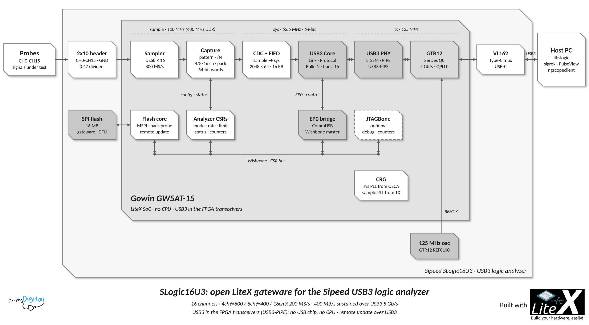

# Gateware

One LiteX SoC ([`slogic_16u3.py`](../slogic_16u3.py)), no CPU: the host drives everything over USB3 (EP0 CSR
accesses, Bulk IN data).

[](images/slogic_16u3-diagram.svg)

The diagram is generated by [`images/slogic_16u3-diagram.py`](images/slogic_16u3-diagram.py) (classic LiteX
style, SVG editable by hand; PNG with Inkscape, see the script). The video's walkthrough uses its boxes
(`--boxes ../illustration/diagram_boxes.json`).

```
                 sample_fast (400MHz, DDR)      sample (100MHz)                       sys (62.5MHz)
 CH0-CH15 ──► IDES8 x16 ──► Capture ──────────────────────► CDC (64-bit) ──► FIFO ──► USB3 Bulk IN (EP1)
              (Sampler)     source/decimation/width/packer/64-bit                       │
                                                                                         ▼
 SPI Flash ◄── Flash core ◄── CSRs/buffers ◄── Wishbone ◄── EP0 CommUSB bridge ◄── USB3 Device Core
  (MSPI)      (runtime pins)                                                             │  Link/Protocol layers
                                                                                         ▼
                                                    USB3-PIPE PHY: LTSSM (sys) + PIPE (tx: 125MHz) ◄─► GTR12 Q0 ◄─► USB-C
```

## Clocks

| Domain        | Frequency | Source                                                                 |
|---------------|-----------|------------------------------------------------------------------------|
| `por`         | ~51.8MHz  | OSCA (internal oscillator), power-on reset.                            |
| `sys`         | 62.5MHz   | PLL from OSCA: USB3 LTSSM/Link/Protocol layers, SoC, Flash.            |
| `tx`/`rx`     | 125MHz    | GTR12 PCS fabric clocks (125MHz oscillator on Q0 REFCLK0): PIPE.       |
| `sample_fast` | 400MHz    | PLL from the GTR12 TX clock (accurate samplerate): IDES8 FCLK (DDR).   |
| `sample`      | 100MHz    | CLKDIV /4 of `sample_fast`: IDES8 PCLK, Capture.                       |

`--sample-clk-source osc` feeds the sample PLL from OSCA instead (no SerDes dependency, internal oscillator
accuracy). `slogic16u3_util clock` measures the sample clock against the host clock.

## Cores

| Core                         | File                                       | Notes                                                                 |
|------------------------------|--------------------------------------------|-----------------------------------------------------------------------|
| CRG                          | [crg.py](../gateware/crg.py)               | OSCA, POR, sys PLL, sample PLL + CLKDIV.                              |
| Sampler                      | [sampler.py](../gateware/sampler.py)       | IDES8 per input: 8 samples per sample clock cycle (Q0 first).         |
| Capture                      | [capture.py](../gateware/capture.py)       | Test pattern, decimation /N (any N), hardware trigger, 4/8/16 channels, 32-bit packer, 64-bit words, limit, overflow. |
| Trigger                      | [trigger.py](../gateware/trigger.py)       | Single stage trigger on the captured samples: per channel low/high/rising/falling/any edge, all ANDed (edge, level, pattern). |
| Pattern Generator            | [generator.py](../gateware/generator.py)   | Capture source 2: UART, SPI, PWM, 100MHz clock, Gray counter at 800MS/s, restarts with each capture. |
| Analyzer                     | [analyzer.py](../gateware/analyzer.py)     | Capture + CDC (64-bit: 400MB/s needs > 32 bits per sys cycle) + FIFO (also the pre-trigger buffer), info/control/status CSRs, sample clock counter. |
| USB3 Device                  | [usb3.py](../gateware/usb3.py)             | USB3-PIPE Device Core: EP0 Wishbone bridge, Bulk IN (64-bit).         |
| Flash                        | [flash.py](../gateware/flash.py)           | SPI master, runtime pads mapping, 512-byte TX/RX buffers.             |

## Capture Datapath

- Base rate 800MS/s (8 samples per 100MHz cycle), samplerate = 800MHz/divider (stock rates: 5-800MHz).
- Decimation: one sample every `divider`, the first sample of the capture kept, several samples per cycle
  compacted below divider 8; single cycle recurrence (table for dividers < 8, one adder above).
- Up to 32 bits per cycle (400MB/s): 4ch@800MS/s, 8ch@400MS/s, 16ch@200MS/s (more: `error`, capture stopped).
- Wire format: sample-major, first sample on the LSBs (4ch: 2 samples per byte), 64-bit words on the
  Bulk IN endpoint, the last word flushed (padded) with a short packet.
- Limit (48-bit) or continuous until stopped, overflow (FIFO full: data lost) stops the capture.
- Hardware trigger (0.2), see below.
- Test sources, end-to-end checks without probes (`slogic16u3_util check`: every sample checked):
  - Counter (pattern 1): sample i = i x divider (16-bit, masked).
  - Pattern generator (pattern 2): protocol-like signals at the base rate after the
    deserializers, restarting with each capture, sample i = generator sample i x divider (libslogic16u3
    `slogic_generator_sample()`, the same model): CH0 UART 1Mbaud 8N1 ("SLogic16U3 LiteX pattern
    generator\r\n", idle at the capture start), CH1-CH3 SPI mode 0 12.5MHz (CS#/SCK/MOSI, "SLOG" every
    5.12us), CH4 PWM ~97.7kHz (duty sweep), CH5 100MHz clock, CH6-CH15 10-bit Gray counter at 100MHz.
    Decodable in sigrok/PulseView (`pattern=generator`). The input pins are not driven (input only
    standard, probes may be connected): the Sampler/IDES8 path itself is checked with real signals.

## Hardware Trigger

- Single stage, sigrok semantics: 4 conditions per channel (`trigger_level`: zero/one, `trigger_edge`:
  rising/falling, both: any edge), channels without condition don't care, all the channels ANDed: edge,
  level, pattern and pattern + edge triggers. Evaluated on the captured (decimated) samples, sample-exact
  (first matching sample of the cycle), no edge on the first sample.
- Pre-trigger window in the capture FIFO (no extra BSRAM): while armed nothing is streamed (USB link idle,
  no host load), the oldest FIFO words are dropped; on the trigger the stream starts at word
  max(0, W - `pretrigger`) (W: word holding the trigger sample) and goes on until `limit` (counted from
  the trigger cycle start) or the stop. `trigger_count`: trigger sample index in the capture, the host
  computes the trigger position in the stream from it (libslogic16u3: `trigger_offset`).
- Depth: FIFO depth - 2 x 64 margin words (1920 words of 64 bits):

  | Channels | Max pre-trigger samples | At the max samplerate | At 1MS/s |
  |----------|-------------------------|-----------------------|----------|
  | 16       | 7680                    | 38.4us (200MS/s)      | 7.7ms    |
  | 8        | 15360                   | 38.4us (400MS/s)      | 15.4ms   |
  | 4        | 30720                   | 38.4us (800MS/s)      | 30.7ms   |

  Deeper pre-trigger: software trigger (libsigrok soft trigger, the driver falls back to it), unlimited
  but the host processes the full stream. The post-trigger part is streamed (unlimited).
- Status crossing: trigger_count/triggered/capture generation in one BusSynchronizer snapshot (a stale
  status of the previous capture is ignored).

## Registers

Fixed CSR map ([slogic_regs.h](../software/user/libslogic16u3/slogic_regs.h), checked against the generated
`csr.csv` by `test/test_regs.py`):

| Bank           | Base   | Registers                                                                       |
|----------------|--------|---------------------------------------------------------------------------------|
| ctrl           | 0x0000 | reset, scratch, bus_errors.                                                     |
| analyzer       | 0x0800 | magic ("SLOG"), version, config, base_rate, control, divider, limit (64), status (+ triggered), count (64), clk_count, trigger, trigger_level, trigger_edge, pretrigger, trigger_count (64). |
| flash          | 0x1000 | control (enable/pads/high), divider, xfer (length/hold), ctrl (start/release), status. |
| usb3_phy       | 0x1800 | status (LTSSM state, U0, ready).                                                |
| identifier_mem | 0x2000 | SoC identifier (one character per word).                                        |
| flash_buffer   | 0x20000000 | 512-byte TX (writes)/RX (reads) buffers.                                    |

## Resources/Timings (Gowin 1.9.12.04, GW5AT-LV15MG132C1, version B)

The design fills most of the GW5AT-15: the USB3 PHY + Device Core alone use ~70% of the logic (64-bit Link
Layer at 62.5MHz). BSRAMs are kept for the deep buffers (USB3 packets slots: 16x1KB, capture FIFO: 2048x64, 16KB), shallow and
initialized memories go to distributed RAM (`gowin_distributed_memories`, Gowin 1.9.10 also rejects initialized
BSRAMs on the GW5AT-15A).

| Build                          | Logic       | BSRAM | sys (62.5) | tx (125)  | sample (100) |
|--------------------------------|-------------|-------|------------|-----------|--------------|
| USB3 only (`--no-analyzer --no-flash`, 1.9.10) | 10368 (69%) | 86%¹ | 83.4MHz | 126.9MHz | -  |
| Full (place_option 3)          | 13222 (88%) | 34/35 | 74.7MHz    | 131.5MHz  | 101.8MHz     |
| Full + hardware trigger (0.2, place_option 3) | 14515 (96%) | 34/35 | 77.3MHz | 131.3MHz | 101.1MHz |

¹ USB3 packets slots optimized out without the Analyzer.

Gowin PnR has no seed and the design is ~90% full: `scripts/build_best.py` builds several place algorithms in
parallel and keeps the one with the best margins (1.9.12: 4 of 5 meet the timings, 1.9.10: 1 of 5).

## Simulation

- `test/test_capture.py`, `test/test_trigger.py`, `test/test_flash.py`: cores against reference models (Migen,
  the trigger window also with separate sample/sys clock domains).
- `test/test_system.py`: USB3 host model (USB3-PIPE) ↔ Device Core (PHY stand-in, 64-bit Link Layer) ↔ the
  same SoC as the hardware target: CSR accesses over EP0, counter pattern captures over Bulk IN.
